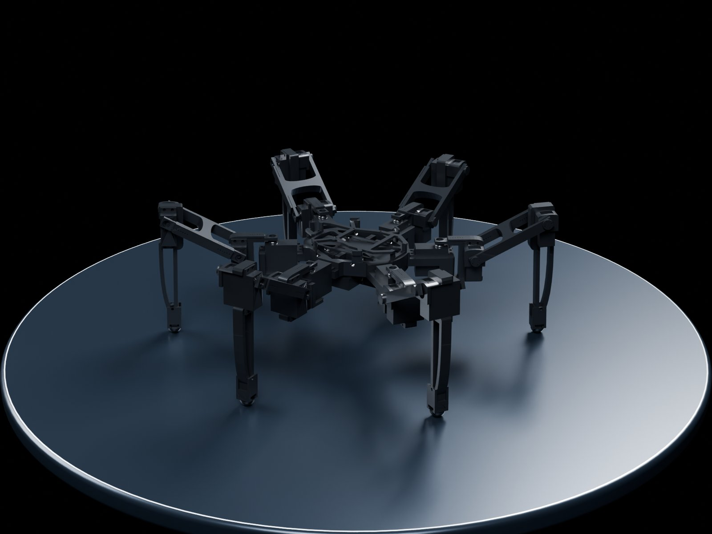
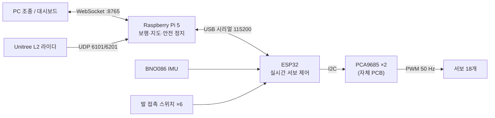
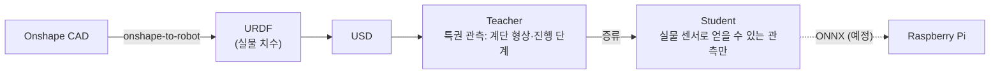
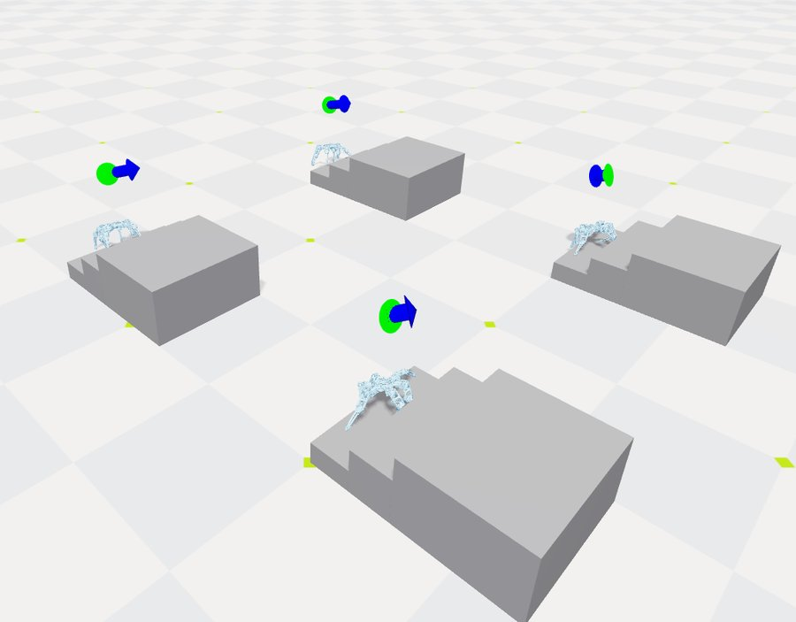
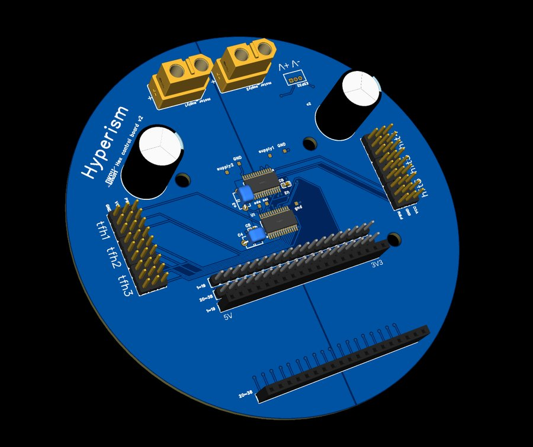

# HexaCore

**An open-source, stair-climbing hexapod built from low-cost hobby servos.**
CAD, PCB, firmware, Raspberry Pi software, the Isaac Lab training stack and measured servo data — all in one repository.



저가 서보로 만든 6족 계단 등반 로봇입니다. 설계·코드·학습 환경·실측 데이터를 모두 공개합니다.
누구나 같은 로봇을 다시 만들고, 고치고, 다른 지형으로 학습시켜 볼 수 있도록 하는 것이 목표입니다.

## 한눈에 보기

| 항목 | 값 |
|---|---|
| 관절 | 18개 (다리 6 × 3) — coxa MG996R ×6, femur·tibia RC9 ×12 (위치 제어 서보) |
| 다리 길이 | femur 100 mm + tibia 137 mm |
| 제어 | Raspberry Pi 5 (상위 제어·라이다) → ESP32 (실시간 서보 제어) → PCA9685 ×2 (자체 설계 원형 PCB) |
| 센서 | Unitree L2 4D 라이다, BNO086 IMU, 발 접촉 스위치 ×6, 포텐 개조 서보 관절각 |
| 학습 | Isaac Lab 3.0 + Newton 백엔드 (Isaac Sim 불필요), RSL-RL, teacher → student 증류 |
| 목표 계단 | 초등학교 법정 상한 단높이 160 mm (「건축물의 피난·방화구조 등의 기준에 관한 규칙」 제15조) |
| 부품비 | 약 89만원 + α (프레임 3만 + 서보 36만 + 라이다 30만 + 라즈베리파이 20만, 나머지 부품 집계 중) |

## 왜 6족인가

- 오픈소스 소프트웨어는 빠르게 퍼지지만, 하드웨어는 물리적으로 다시 만들어야 해서 덜 퍼집니다 [2].
- 공개된 다리 로봇은 4족·2족에 몰려 있습니다. IEEE RAM 오픈 로봇 하드웨어 서베이(2023)의 다리 로봇 절에서 4족 10, 2족·휴머노이드 10, **6족 1** [2].
- 저가 위치 제어 서보는 토크 제어가 안 돼서 동적 보행이 어렵고, 늘 정적으로 안정해야 합니다.
  6족은 다리 3개를 들어도 3개가 남아 삼각형으로 몸을 받칩니다. 대가는 속도입니다.

## How it works

### 시스템 구조



- **ESP32** ([`firmware/`](firmware/)): `<다리,관절,각도>` 명령을 받아 서보를 움직이고, IMU 자세(100 Hz)·발 접촉·하트비트를 돌려보냅니다. 명령이 0.5초 끊기면 서기 자세로 멈춥니다.
- **Raspberry Pi** ([`software/raspberrypi/`](software/raspberrypi/)): 삼각 보행 50 Hz, 2D 점유 격자 지도 5 Hz, WebSocket 서버.
- **PC** ([`software/pc/`](software/pc/), [`software/dashboard/`](software/dashboard/)): WASD 조종, 지도·센서 대시보드.

### 학습 파이프라인



- 서보 모델: 스톨 토크·무부하 속도·지속 토크(스톨의 70%)를 반영 (`DCMotorCfg`, [`env_cfg.py`](learning/src/RLforHexapod/tasks/walk/config/hexapod/env_cfg.py)).
- Student 관측: IMU(각속도·중력 방향), 발 접촉, 관절각, 이전 행동, 라이다를 흉내 낸 높이맵 ([관측 시험 계획](learning/docs/student_observation_test.md)).

## 결과

> 시뮬레이션과 실물을 나눠 적습니다. 실물 계단 시험은 아직 하지 않았습니다.

**시뮬레이션** (Isaac Lab 3.0 + Newton, 실물 치수 URDF, 서보 모델 반영)



| 정책 | 계단 | 결과 |
|---|---|---|
| Teacher | 단높이 160 mm × 3단 + 꼭대기, 단너비 300 mm (경사 28.1°) | 꼭대기 도착 확인 — 고정 시드 평가(k/N) 정리 중 |
| Student | 같은 계단 | 약 80% (개선 중) — 고정 시드 평가(k/N) 정리 중 |

성공 = 꼭대기 도착. 평가 스크립트: [`learning/scripts/eval_stairs.py`](learning/scripts/eval_stairs.py)

| 계단 | 경사 (atan 단높이/단너비) |
|---|---|
| 선행연구 SpiderPi + RL, 실물 14.0/38.1 cm [4] | 20.2° |
| **HexaCore 시뮬 16/30 cm** | **28.1°** |
| 초등학교 법정 상한 16/26 cm [5] | 31.6° |

**실물**

- 평지 삼각 보행 확인
- femur 서보 부하 처짐 약 1.3° (서보 포텐셔미터를 개조해 측정, [`data/servo_pot_sweep/`](data/servo_pot_sweep/))
- 서보 18개 0°·90°·180° 캘리브레이션

## 하드웨어 없이 돌려보기

라즈베리파이 노드는 ESP32·라이다가 없으면 시뮬레이션으로 동작합니다. PC에서 바로 실행할 수 있습니다.

```bash
pip install -r software/raspberrypi/requirements.txt
python3 software/raspberrypi/robot_main.py --sim
```

다른 터미널에서 조종하거나:

```bash
python3 software/pc/pc_client.py --host localhost
```

브라우저로 `software/dashboard/index.html?ws=ws://localhost:8765` 를 열면 지도와 센서 값을 볼 수 있습니다.

## 저장소 구성

| 폴더 | 내용 |
|---|---|
| [`firmware/`](firmware/) | ESP32 펌웨어 (`firmware/` 현재판, `myFirmware/` 최종판 예정) + 서보 점검·캘리브레이션 도구 |
| [`software/`](software/) | 라즈베리파이 상위 제어기, PC 조종 클라이언트, 대시보드 |
| [`learning/`](learning/) | Isaac Lab 3.0 강화학습 환경 (걷기, 계단 teacher, student 증류) |
| [`hardware/`](hardware/) | 부품 목록(BOM), 3D 프린팅 STL, Onshape CAD 링크, PCB 거버·핀 배치 |
| [`data/`](data/) | 실측 데이터 (포텐 개조 서보 각도 스윕) |
| [`tools/`](tools/) | 2D 기구학·계단 발판 탐색, 정책 ONNX 변환, 프린팅용 STL 변환 |
| [`legacy/`](legacy/) | 강화학습 이전, PC에서 블루투스로 직접 조종하던 규칙 기반 보행·계단 코드 |



## 빌드 가이드 (작성 중)

1. 부품 구매 — [`hardware/bom/BOM.csv`](hardware/bom/BOM.csv)
2. 3D 프린팅 — [STL 10종 51개](hardware/README.md#3d-프린팅-부품), CAD 원본은 [Onshape](https://cad.onshape.com/documents/f646c0fde8bd91cfa43cbae7/w/279609403375cff4404c6eae/e/76a6985095c8e8f19d67aec6)
3. PCB 주문·납땜 — [거버·핀 배치](hardware/pcb/)
4. 조립
5. 펌웨어 업로드
6. 서보 캘리브레이션 — [`firmware/tools/`](firmware/tools/)
7. 라즈베리파이 설정 — [`software/raspberrypi/`](software/raspberrypi/)
8. 조종

## 한계와 다음 단계

- 실물 계단 시험 전입니다. 50 → 100 → 160 mm 순서로 시험할 예정입니다.
- 계단 높이 하나로 학습했습니다. 높이·너비 랜덤화 재학습 후 법정 상한(160 mm / 260 mm, 31.6°)을 목표로 합니다.
- 라이다 패킷 해석과 SLAM(Point-LIO) 연동은 진행 중입니다. 지금 지도는 오도메트리만 써서 오래 걸으면 밀립니다.
- 빠르지 않습니다. 항상 다리 3개 이상으로 몸을 받치는 대가입니다.

## 참고

이 프로젝트의 공개 방식은 [Stanford Pupper](https://github.com/stanfordroboticsclub/StanfordQuadruped)에서 영감을 받았습니다.

1. Open Robotics, *2025 ROS Metrics Report*, 2026.
2. A. Patel, M. Liarokapis, A. Dollar, "Open Robot Hardware," *IEEE Robotics & Automation Magazine* 30(3), 2023.
3. J. Bonvoisin et al., "Collaborative Open Source Hardware Development," *Design Science* 4, 2018.
4. T. Qu et al., "Versatile Locomotion Skills for Hexapod Robots," arXiv:2412.10628, 2024.
5. 「건축물의 피난·방화구조 등의 기준에 관한 규칙」 제15조 제2항.

## 라이선스

| 대상 | 라이선스 |
|---|---|
| 코드 | [MIT](LICENSE) |
| 하드웨어 설계 (CAD, PCB, URDF) | [CERN-OHL-P-2.0](LICENSES/CERN-OHL-P-2.0.txt) |
| 데이터·문서·사진 | [CC BY 4.0](LICENSES/CC-BY-4.0.txt) |

폴더별 적용 범위와 예외는 [LICENSES/README.md](LICENSES/README.md), 외부 라이브러리는 [THIRD_PARTY_NOTICES.md](THIRD_PARTY_NOTICES.md)를 보세요.

## 팀

단국대학교부속소프트웨어고등학교 **HexaCore** — 오연우, 박수용, 양서진
