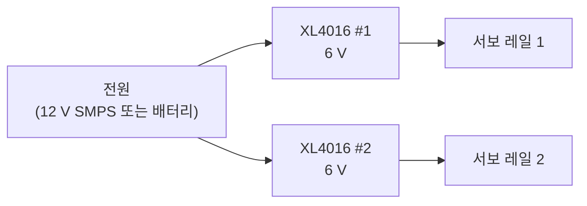

# 4. 조립·배선

!!! note "작성 중"
    단계별 조립 사진은 정리하고 있습니다. 지금은 조립할 때 꼭 맞춰야 하는 정보만 적어 둡니다.
    전체 모양은 [Onshape CAD](https://cad.onshape.com/documents/f646c0fde8bd91cfa43cbae7/w/279609403375cff4404c6eae/e/76a6985095c8e8f19d67aec6)의 조립품을 참고하세요.

## 다리 번호와 서보

- 다리 1·6이 앞, 2·5가 가운데, 3·4가 뒤입니다. 1~3이 한쪽, 4~6이 반대쪽입니다.
- 다리마다 coxa에 **MG996R**, femur·tibia에 **RC9**를 씁니다.

서보 선은 아래 채널에 꽂습니다. 펌웨어와 점검 도구가 모두 이 배치를 씁니다.

| 다리 | coxa (hip) | femur | tibia |
|---|---|---|---|
| 1 | U1 ch2 | U1 ch1 | U1 ch0 |
| 2 | U1 ch5 | U1 ch4 | U1 ch3 |
| 3 | U1 ch8 | U1 ch7 | U1 ch6 |
| 4 | U1 ch11 | U1 ch10 | U1 ch9 |
| 5 | U1 ch14 | U1 ch13 | U1 ch12 |
| 6 | U2 ch2 | U2 ch1 | U2 ch0 |

U1 = 주소 0x41 보드, U2 = 0x40 보드입니다.

## 전원

!!! warning "컨버터 출력부터 맞추기"
    서보를 꽂기 전에 멀티미터로 두 컨버터의 출력을 6 V로 맞추세요.

## 센서

- **발 접촉 스위치**: 다리마다 하나. 한쪽 선은 ESP32 GPIO(다리 1~6 = 4, 16, 17, 5, 18, 19), 다른 쪽은 GND.
- **IMU (BNO086)**: 서보 드라이버와 다른 I2C 버스(SDA 32 / SCL 33)에 연결합니다. 붙이는 방향은 자유입니다. 6단계에서 수평을 기억시킵니다.
- **라이다 (Unitree L2)**: 라즈베리파이 이더넷에 연결합니다 ([7단계](raspberrypi.md)).
- **ESP32 ↔ 라즈베리파이**: USB 케이블.
