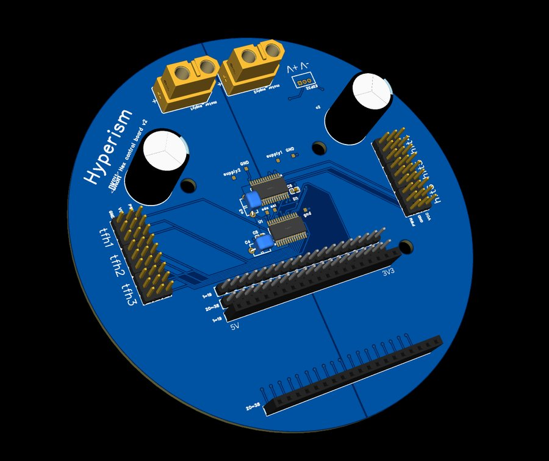

# 3. 제어 PCB

ESP32와 PCA9685 서보 드라이버 2개를 올리는 원형 2층 기판(지름 111 mm)입니다. EasyEDA Pro로 설계했습니다.

## 주문

1. [`hardware/pcb/gerber/Gerber_PCB1.zip`](repo:hardware/pcb/gerber/Gerber_PCB1.zip)을 받습니다.
2. 압축을 풀지 않고 PCB 업체(JLCPCB 등) 주문 페이지에 올립니다.
3. 층 수·두께는 업체 기본값(2층, 1.6 mm)으로 둡니다.

EasyEDA 주문 안내: <https://prodocs.easyeda.com/en/pcb/order-order-pcb/index.html>

## 연결

| 신호 | ESP32 핀 | 비고 |
|---|---|---|
| 서보 I2C | SDA 21 / SCL 22 | PCA9685 U1 = 0x41, U2 = 0x40, 50 Hz |
| IMU I2C | SDA 32 / SCL 33 | BNO086, 0x4A(Adafruit) 또는 0x4B(SparkFun), 100 kHz |
| 발 접촉 스위치 1~6 | 4, 16, 17, 5, 18, 19 | 반대쪽은 GND, 내부 풀업 (눌림 = LOW) |
| 라즈베리파이 | USB 시리얼 115200 | |

두 PCA9685의 주소가 달라야 합니다(0x40, 0x41). 주소는 보드의 A0~A5 점퍼로 정합니다.

!!! warning "GPIO 5"
    GPIO 5는 ESP32 부팅 스트래핑 핀입니다. 전원을 켤 때 발 스위치가 눌려 있으면 부팅이 안 될 수 있으니 다리를 띄운 채로 켜세요.

!!! note "아직 없는 것"
    회로도 PDF와 EasyEDA 원본은 정리하고 있습니다. 납땜할 부품 목록도 회로도와 함께 올릴 예정입니다.
