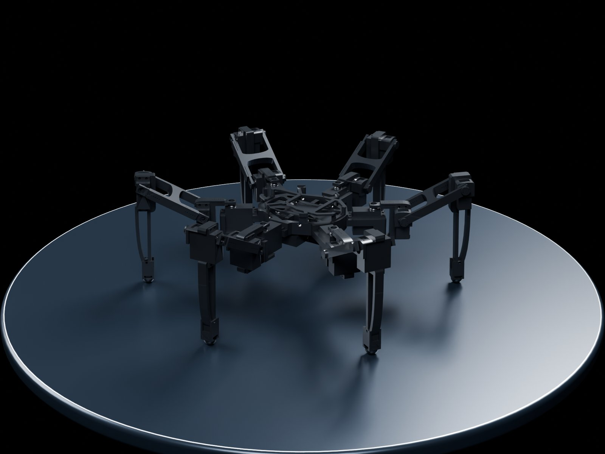

# HexaCore 빌드 가이드

HexaCore는 저가 취미용 서보 18개로 만든 6족 계단 등반 로봇입니다.
이 가이드는 부품을 사서 로봇을 조립하고, 펌웨어를 올리고, PC에서 조종하기까지의 순서를 담고 있습니다.

## 순서

| 단계 | 내용 | 상태 |
|---|---|---|
| [1. 부품 구매](build/parts.md) | 부품 목록(BOM)과 필요한 공구 | 일부 가격·볼트 목록 작성 중 |
| [2. 3D 프린팅](build/print.md) | 프린팅 부품 10종 51개 | 있음 |
| [3. 제어 PCB](build/pcb.md) | 거버로 PCB 주문, 핀 배치 | 회로도 작성 중 |
| [4. 조립·배선](build/assembly.md) | 다리 번호, 서보 배치, 전원·센서 배선 | 조립 사진 작성 중 |
| [5. 펌웨어 올리기](build/firmware.md) | ESP32에 Arduino 펌웨어 올리기 | 있음 |
| [6. 서보 보정](build/calibration.md) | 서보 점검, 기준 위치, IMU 수평 | 있음 |
| [7. 라즈베리파이 설정](build/raspberrypi.md) | 상위 제어기, 라이다 네트워크 | 있음 |
| [8. 조종](build/operate.md) | 키보드 조종, 대시보드, 안전 정지 | 있음 |

!!! tip "로봇 없이 먼저 해 보기"
    라즈베리파이 프로그램은 ESP32·라이다가 없으면 시뮬레이션으로 돕니다.
    PC에서 [7단계](build/raspberrypi.md)의 `--sim` 실행과 [8단계](build/operate.md)의 조종을 먼저 해 볼 수 있습니다.

## 이 가이드에서 쓰는 이름

- **다리 1~6**: 1·6이 앞, 2·5가 가운데, 3·4가 뒤입니다. 1~3이 한쪽, 4~6이 반대쪽입니다.
- **coxa (hip)**: 몸통에 붙어 다리를 앞뒤로 돌리는 관절. MG996R 서보.
- **femur**: 다리를 위아래로 드는 관절. RC9 서보. 길이 100 mm.
- **tibia**: 무릎 관절. RC9 서보. 길이 137 mm.

## 더 보기

- [시스템 구조](reference/system.md) — 보드끼리 어떻게 이어지는지
- [강화학습](reference/learning.md) — 시뮬레이션에서 계단 오르기 학습
- [저장소](repo:) — 코드·설계 파일 전체
