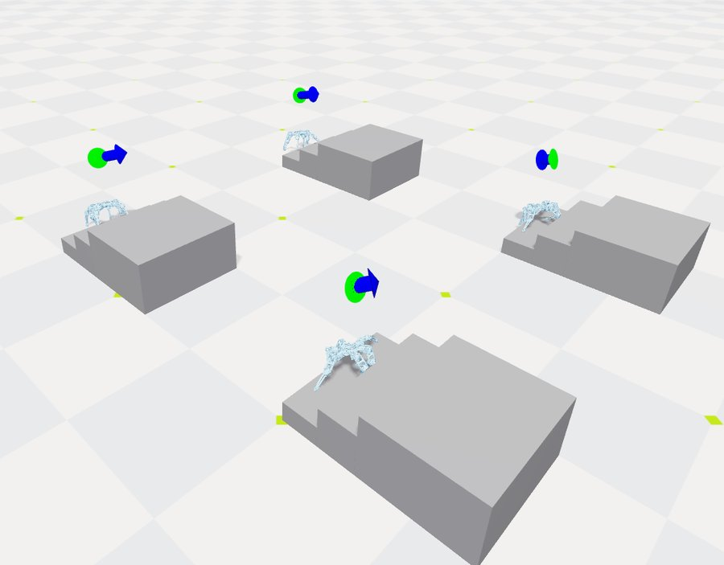
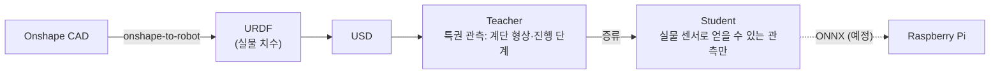

# 강화학습

Isaac Lab 3.0 + Newton 백엔드(Isaac Sim 불필요), RSL-RL로 시뮬레이션에서 계단 오르기를 학습합니다.

- **teacher**: 시뮬레이션만 아는 정보(계단 형상, 지금 몇 번째 단인지)를 받아 빨리 배웁니다.
- **student**: IMU(각속도·중력 방향), 발 접촉, 관절각, 이전 행동, 라이다를 흉내 낸 높이맵만 받습니다. teacher의 행동을 따라 하도록 배웁니다.
- **서보 모델**: 스톨 토크·무부하 속도·지속 토크(스톨의 70%)를 반영합니다.
- **계단**: 단높이 160 mm × 3단 + 꼭대기, 단너비 300 mm (경사 28.1°).

## 결과

시뮬레이션 결과이며, 실물 계단 시험은 아직 하지 않았습니다.

| 정책 | 결과 |
|---|---|
| Teacher | 꼭대기 도착 확인 — 고정 시드 평가(k/N) 정리 중 |
| Student | 약 80% (개선 중) — 고정 시드 평가(k/N) 정리 중 |

## 다시 해 보기

설치·학습·평가·ONNX 내보내기 명령은 [`learning/README.md`](repo:learning/README.md)에 있습니다. NVIDIA GPU가 필요합니다.
