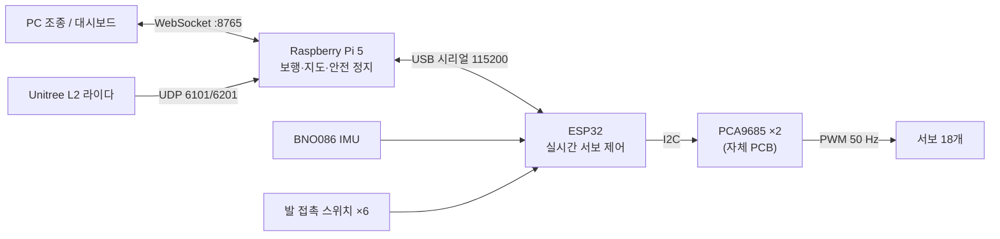

# 시스템 구조

| 부분 | 코드 | 하는 일 |
|---|---|---|
| ESP32 | [`firmware/`](repo:firmware/) | 관절 명령 → 서보 PWM, IMU 자세·발 접촉·하트비트 전송 |
| Raspberry Pi | [`software/raspberrypi/`](repo:software/raspberrypi/) | 삼각 보행 50 Hz, 2D 지도 5 Hz, 안전 정지, WebSocket 서버 |
| PC | [`software/pc/`](repo:software/pc/), [`software/dashboard/`](repo:software/dashboard/) | 키보드 조종, 지도·센서 대시보드 |
| 학습 | [`learning/`](repo:learning/) | Isaac Lab 계단 오르기 학습 ([강화학습](learning.md)) |

## 왜 6족인가

- 공개된 다리 로봇은 4족·2족에 몰려 있습니다. IEEE RAM 오픈 로봇 하드웨어 서베이(2023)의 다리 로봇 절에는 4족 10, 2족·휴머노이드 10, 6족 1이 실려 있습니다.
- 저가 위치 제어 서보는 토크 제어가 안 돼서 동적 보행이 어렵고, 늘 정적으로 안정해야 합니다.
  6족은 다리 3개를 들어도 3개가 남아 삼각형으로 몸을 받칩니다. 대가는 속도입니다.

## 관절 범위

[`hardware/cad/onshape-to-robot.json`](repo:hardware/cad/onshape-to-robot.json) 기준 (URDF 변환에 쓰는 값).

| 관절 | 서보 | 최대 토크 (N·m) | 최대 속도 (rad/s) | 범위 (rad) |
|---|---|---|---|---|
| coxa | MG996R | 0.92 | 5.51 | −π/2 ~ π/2 |
| femur | RC9 | 1.86 | 6.55 | 0 ~ π |
| tibia | RC9 | 1.86 | 6.55 | −π ~ 0 |
