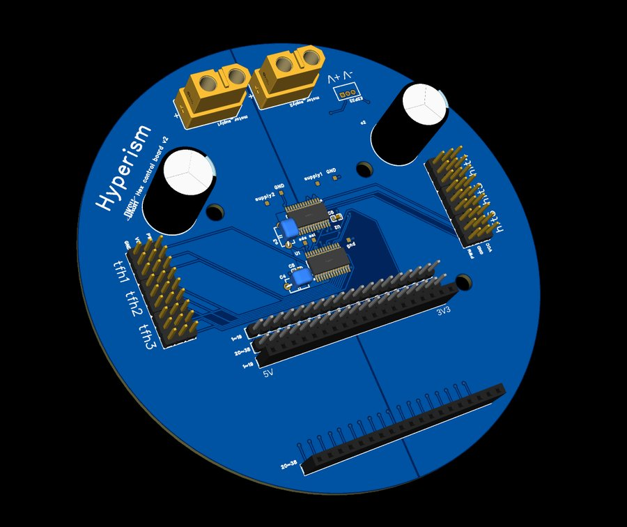

# 제어 PCB

ESP32와 PCA9685 ×2를 올리는 원형 2층 기판입니다. EasyEDA Pro v3.2로 설계했습니다.

| 항목 | 값 |
|---|---|
| 모양 | 원형, 지름 111 mm |
| 층 | 2층 |
| 가장 작은 드릴 | 0.305 mm (비아) |

## 주문

[`gerber/Gerber_PCB1.zip`](gerber/Gerber_PCB1.zip)을 압축을 풀지 않고 PCB 업체(JLCPCB 등) 주문 페이지에 올리면 됩니다.
층 수·두께·색은 업체 기본값(2층, 1.6 mm)으로 두면 됩니다. EasyEDA 안내: <https://prodocs.easyeda.com/en/pcb/order-order-pcb/index.html>

## 연결

펌웨어([`firmware/firmware/firmware.ino`](../../firmware/firmware/firmware.ino)) 기준입니다.

| 신호 | ESP32 핀 | 비고 |
|---|---|---|
| 서보 I2C | SDA 21 / SCL 22 (`Wire`) | PCA9685 U1 = 0x41, U2 = 0x40, 50 Hz |
| IMU I2C | SDA 32 / SCL 33 (`Wire1`) | BNO086, 0x4A(Adafruit) 또는 0x4B(SparkFun), 100 kHz |
| 발 접촉 스위치 1~6 | 4, 16, 17, 5, 18, 19 | 반대쪽은 GND, 내부 풀업 (눌림 = LOW) |
| 라즈베리파이 | USB 시리얼 115200 | `<다리,관절,각도>` |

GPIO 5는 부팅 스트래핑 핀입니다. 전원을 켤 때 발 스위치가 눌려 있으면 부팅이 안 될 수 있으니, 다리를 띄운 채로 켜세요.

### 서보 채널

| 다리 | coxa (hip) | femur | tibia |
|---|---|---|---|
| 1 | U1 ch2 | U1 ch1 | U1 ch0 |
| 2 | U1 ch5 | U1 ch4 | U1 ch3 |
| 3 | U1 ch8 | U1 ch7 | U1 ch6 |
| 4 | U1 ch11 | U1 ch10 | U1 ch9 |
| 5 | U1 ch14 | U1 ch13 | U1 ch12 |
| 6 | U2 ch2 | U2 ch1 | U2 ch0 |

## 아직 없는 것

- EasyEDA Pro 원본(`.epro`)과 회로도 PDF
